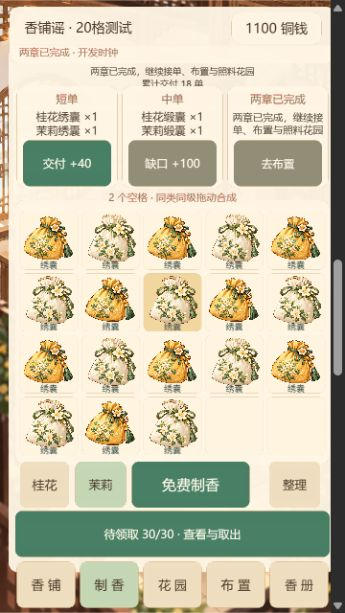
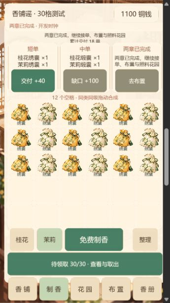

# 香铺谣 · 持续进度

当前阶段：S4「棋盘与布局真机验证」测试准备已交付，阶段验收待实测（2026-10-10）。用户明确暂无设备与玩家；Cocos Creator 3.8.7，版本0.4.0，contentMaxChapter=2。productionBoardPreset仍为null，不选定正式棋盘，不进入S5。

## 2026-10-10 动态表现规格修订（待实现）

- 已更新根目录 `香铺谣_分阶段开发规格与Codex步骤.md`，新增“动态表现与美术还原”“当前代码已确认的问题与接入位置”“针对现有代码的接入约束”和“动态第1轮”执行指令。修订依据为提交 `e2708f4` 的实际源码。
- 本次只提交规格与进度说明；没有完成角色素材、动画代码、Creator构建或新的运行验收，不能把本节当作动画已实现。
- 当前优先执行“动态第1轮”：阿绫的局部呼吸、真实眨眼、说话和交单致意；灯笼与香烟；出货、合成及当前可见页面的交单反馈。具体素材、接入位置、生命周期和录屏要求以更新后的同名规格为准。
- S4真机与玩家测试仍待补，`productionBoardPreset=null`，本轮不进入S5。动态表现工作可以先进行，不以缺设备为由停止可做的部分。
- 保留现有玩法、经济与存档，不重做S1，不清空主线档，不覆盖S4研究记录。只维护本文件及既有规格文件。

## S4 交付、实际画面与进展

- 图文交付文档：根目录 `S4_交付文档.html`，浏览器阅读地址 `http://127.0.0.1:7484/delivery.html`。本文件仍是唯一持续进度记录。
- 实际S4测试入口：`http://127.0.0.1:7484/`；固定20格入口 `/20/`，固定30格入口 `/30/`。当前7456的旧S3入口保留；`npm start`新启动的服务使用当前S4构建。需要独立端口可运行 `node tools/serve.cjs 7484`。
- 可编辑主场景 `assets/scenes/S4.scene`；正式Creator构建 `build/s4-web`，打包后输出完整的 `build/s4-20` 与 `build/s4-30`。两包共用同一玩法/美术/时钟/奖励与初始内容，仅测试棋盘和对应格子布局不同。原S1—S3场景、旧构建、Image原图及主线存档保留。

| 交付项 | 当前状态 | 证据层 |
| --- | --- | --- |
| 20格与30格测试构建 | 已完成 | 官方Creator构建完成日志、两份构建目录及package-manifest.json |
| 第一章、第二章、奖励堆积初始内容一致 | 已通过程序核对 | fixture-parity.json、3组对照单元测试 |
| A/B测试档与主线隔离、禁止降容截断 | 自动检查通过 | S4隔离测试及S1—S3回归；本次未重写主线档 |
| 满盘、整理、占用、拖拽、交单和装修耗时埋点 | 已实现并做短时浏览器检查 | core-tests.json、a20-interaction-report.json、a20-pressure-interaction-report.json |
| 360×640窄屏浏览器画面 | 已执行 | 实际iframe视口360×640、A格60.5/B格50逻辑像素、当前页面按钮预检无不足48项；不是手机证据 |
| 2台不同尺寸/性能Android、1台iPhone | 未执行 | ADB未发现连接设备；用户确认暂时没有设备 |
| 约10位玩家，每版10分钟、5位AB/5位BA | 未执行 | records-template.json为空，未虚构偏好、误拖或经营效率结论 |
| 最终棋盘选型 | 待实测 | decision.json=status pending，productionBoardPreset=null |

### 实际画面（浏览器运行截图）

下面两张来自最终S4 Cocos包，都是360×640浏览器视口和相同的显式压力测试档：棋盘18件、待领30件、花园两地块各16件、1100铜钱、两章完成。初始进度是开发测试夹具，不是本轮玩家免费通关结果。仅容量不同：A剩2格，B剩12格。

店景保留现有美术、灯笼、门帘、柜台及第二章角色。已修复扩大触摸区域时覆盖按钮原有颜色的问题，最终画面“去制香”及缺口按钮状态清晰。

### 埋点口径与测试档

- 每个测试档含棋盘、匿名玩家编号、场景及轮次：`s4-test-A_5x4-编号-场景-轮次`与B档分离。同档重开恢复；新对比必须使用新轮次，不清空旧档。
- 第一章新档：0铜钱、2个GUI_1；第二章：同样6单/160铜钱、桂花教学库存2；压力场景：相同18件棋盘、待领30、两地块各16。夹具由同一核心业务路线生成，压力摆盘单独显式设定。生产/主线绝不使用夹具。
- 满盘阻塞：仅棋盘无空格拒绝出货/取物，同一满盘布局连续点击合并为一个事件；待领队列容量不足单独处理，不计棋盘阻塞。
- 整理次数：确认业务提交的寄售/回收；压力场景不计入自然经营整理次数。每笔确认事务采样空格数和占用率，输出占用率95分位。
- 拖拽事件输出来源格、实际落点、合成/移动/交换/取消及事件ID。观察员手工复核“符合预期/非预期/主动试探”；未复核时误拖率为null，主动试探单独计数，不凭取消自动认定误拖。
- 有效经营时间使用单调时钟；后台暂停、手工继续，600秒封顶。记录本次交单增量、关键装修节点耗时、帧时间95分位和超过50毫秒帧数。帧统计分桶上限200毫秒，超过上限明确标记，不冒充精确数值。
- 换视口、载入非初始旧档或计时之外改变经营状态会标记该研究记录无效；研究备份与游戏存档使用不同键。自然经营隐藏时间注入按钮，压力准备仍明确使用开发测试时间。
- 导出JSON可包含机型、系统、宿主、证据文件名、观察结论与偏好原因；“真机”选项只是登记，必须附证据并由观察员核实。浏览器数据不进入最终选型。

### 已执行结果与修复

- 2026-10-10完整自动回归：S1 66/66、S2 64/64、S3 93/93、S4准备13/13，总计236/236。最后按钮颜色修复后实际重看A/B压力与店景，并复核类型；不把单元测试当真机通过。
- Creator真实引擎类型检查0错误；官方s4-web构建完成。压缩选项回退及编辑器启动/配置诊断保留于 `creator-build.*.log`，不声称零警告。
- 20格新档实际鼠标合成→交付首单：18.15秒有效记录、1次拖拽、1单；钱包0→40，空格18→19→20。该次操作按预期复核，但样本只有1次且不到10分钟，不能据此声称玩家误拖率或完成效率合格。
- 20格压力场景实际点批量取出：棋盘18→20、待领30→28；连续两次满盘取物仍保留28，埋点只计1次满盘事件。短时记录9.81秒、无交单、无自然整理；此数据不用于自然满盘中位数。
- 30格第二章与相同压力档实际加载、店景切换已执行。最终A/B压力档按钮尺寸预检均无不足48逻辑像素项；这只证明采样页面尺寸，不证明真机触摸、安全区、遮挡或全部页面验收。
- 浏览器改变窗口尺寸出现Cocos `Unexpected screen orientation:13`警告，运行诊断未捕获游戏error；保留原始日志。

### 实测步骤与最终判定

1. 准备2台不同尺寸/性能Android和1台iPhone，分别运行A/B第一章、第二章、压力场景；记录系统、尺寸/性能档、宿主及截图/录像。手机可接入可访问的本地Web Mobile服务器，或把完整构建放入授权测试环境；当前服务仅绑定127.0.0.1，不自动公开局域网服务。
2. 约10位目标玩家使用匿名编号；P01—P05按AB，P06—P10按BA。每版各10分钟自然经营，使用相同初始内容；压力检查另开场景。先载入，再开始计时；暂停后继续前检查无计时外操作。
3. 逐次复核拖拽；记录格子辨识、目标可见、胶囊/手势区、丢物/重复奖励/强制广告问题。测试页导出各次JSON，汇总到 `records-template.json` 的runs，并在preferences填写每人choice与reason；模板本身不是结果。
4. 执行 `node tools/evaluate-s4.cjs 汇总JSON绝对路径` 输出判定。两组均需数据安全通过、主要格/按钮≥48逻辑像素、观察误拖率≤5%、自然满盘中位数≤2次/10分钟。A效率≥B的90%、A整理最多多1次、至少6/10偏好A且两组通过才选20格；其余B通过才选30格，两组均失败则修复重测。
5. 当前不执行选型，Config.ts中的productionBoardPreset仍null。缺少实际设备与玩家记录时，工具返回pending；取得证据后还需复核不同性能/尺寸的设备覆盖、真实顺序及统计口径，再写正式配置并移除正式包测试入口。

后续S4仍需补齐设备和玩家数据，依据规则选型并处理安全区/胶囊/拖拽与容量问题；当前先按上方动态修订执行“动态第1轮”，两者验收状态分别记录。S5时间服务、云存档、广告和宿主接口尚未接入。

## S3 运行与交付（历史记录）

- S3交付时主场景 `assets/scenes/S3.scene`，当时构建产物 `build/s3-web`、入口7456。当前npm命令已更新为上方S4；旧场景、旧构建、Image原图和已有主线存档保留。
- `build-config.json` 声明 contentMaxChapter=2、developmentTestClock=true、debug=true；构建前生成对应编译常量。构建脚本明确拒绝把S3测试时钟打进正式包。当前是开发验收版，未接S5正式UTC时间服务。
- 主线命名空间继续使用 `main-v1-棋盘配置`；已验证的s2.1存档按完整事务升级到s3.1，保留钱包、物品ID与位置、装扮和当前普通单；未知/不可迁移数据不清空。
- 独立测试入口 `?s3test=1&profile=自定英文编号`，加 `&preset=A` 使用20格，否则30格；与主线和S1/S2测试档隔离。`?core=1`保留S1入口。
- `npm test`运行S1、S2、S3三组回归，可单独用 `npm run test:s3`；`npm run typecheck`使用真实Creator引擎类型。
- 本轮只更新这份PROGRESS.md；所有S3截图、测试与日志在 `evidence/s3`。
- 2026-10-10收尾：核对既有证据与最终构建，恢复7456试玩入口。游戏源码与2026-10-08验收构建保持一致，未重复运行历史223项测试；本次仅整理交付记录及构建诊断路径文案。

## S3 已实现与关键决定

- 第一章完成后一次性进入第二章：茉莉1—4级、S/M/章节三位订单、桂花地块。已出现而未交付的第一章S单保留，交完后从第二章S0开始；M按GUI_4、JAS_4、GUI_3+JAS_3循环。
- 小满C2a为JAS_3×2、120铜钱；完成后两款柜台各180解锁。首次使用新柜台开放周婶C2b（GUI_4+JAS_4，260铜钱）。完成C2b、累计18单、曾使用新柜台后标记第二章完成，茉莉地块开放且初始0。
- 两章完成后继续S/M、装扮、香册、花园，没有第三章入口。三处装扮均有真实独立部件；新柜台可以预览、取消、购买并摆上、免费换回，原有灯笼/门帘行为不变。
- 待领取30件，包含entryId、sku、remainingCount、sourceId、createdSequence；预留也占容量。来源回调去重，容量不足不提交普通奖励。花园按可容纳数量部分入库，其余留在地块。
- 点击一条取1件；批量取创建顺序中可放入的数量，行优先入棋盘；扣待领与加棋盘同一事务，稳定请求ID可防重试重复取物。满盘不改数据，无反向存放、过期或自动出售。
- 桂花、茉莉各30分钟产1件对应2级品，地块最多16，单次结算最多8小时；满仓余时清零，时间倒退不新增或回写较早锚点，跨日不清库存/余时。
- 在线60秒、进入花园、收获、隐藏及返回前台尝试结算；收获先结算再部分转移，全部保存。时间不可用时只展示最后库存并说明联网后结算，基础经营仍可用。
- 桂花教学2件在首个可用时间锚点到达时一次性初始化；时间不可用先记录解锁意图。茉莉初始0。测试时钟使用显式UTC锚点加单调增量，不用设备Date.now发生产出；可注入30分钟/8小时和模拟离线，所有相关页面明确写“开发测试时间”。
- 香册8个条目，只在香品实际进入棋盘时收录，待领或花园中出现不提前收录；收录永久保存。
- 复现并修复旧版双槽保护缺陷：一槽有效、另一槽未知/不可迁移时，禁止普通提交覆盖未知原字节；缓存事务也重新检查槽位，旧revision不覆盖新确认状态。`pre-fix-storage-audit.json`记录修复前未知槽被覆盖，新的混合槽与迁移失败回归通过。结构完整但未知的数据会暂停经营并保留，支持版本升级的旧S2数据仍可迁移。
- 使用内置image_gen依据Image参考及S2店景制作9个新PNG：花园、小满、周婶、两款柜台、茉莉1—4。放在 `assets/resources/s3`，完整来源与提示词在 `tools/s3-art-sources.json`；原图未改。柜台是单独透明图层，非一张装修前后宣传图。

## S3 实际验收证据

- `core-tests.json` / `core-tests.stdout.log`：93/93通过；包含A/B从新档无广告完成两章、S/M循环、保留旧普通单、S2升级、一次教学补给、九个离线样例、分段/整段2小时等价、时间倒退/不可用、跨日、FIFO部分取物、预留容量、32→30部分收获、来源及请求去重、事务四故障点、未知槽保护与迁移失败。CLI路线含5张M单与4张第二章S单，18单剩1100铜钱；这与下面真实输入路线不同，不混写。
- `s1-regression.stdout.log` 66/66、`s2-regression.stdout.log` 64/64通过；总计223项。`typecheck.log`真实引擎类型0错误。
- 官方Creator完成最终s3-web构建。`creator-build.*.log`保留原始诊断：压缩选项回退默认值，最后一次另有编辑器扩展列表刷新HTTP502；构建完成，不声称零警告。修复了Windows PowerShell默认编码导致中文配置读取失败的问题，统一显式UTF-8。
- 真实Cocos Web Mobile包、浏览器鼠标输入、独立7479验收档：从两只GUI_1与T0开始，第一章6单剩160；交保留S单后180；C2a后300；买青瓷柜台后120；C2b后380；再实际交1张M与8张S，累计18单、770铜钱、两章完成、S/M继续。没有广告或付费补给。见 `chapter-two-unlocked.png`、`counter-owned-zhou.png`、`c2b-delivered.png`、`medium-order-delivered.png`、`both-chapters-complete.png`。
- 桂花教学地块初始2、茉莉锁定，见 `garden-teaching.png`；两章完成时茉莉初始0，见 `jasmine-garden-unlocked.png`。GUI后来自然增长到3属于开发时钟经过了30分钟，未重复发教学。
- 实际点击“测试+8小时”，两地块满仓32；收获GUI16、JAS14，待领30、JAS剩2，见 `two-plots-capacity-30.png`。这是注入时间，不能称为等待了真实8小时或正式服务器离线结算。
- 实际点取1件：待领30→29；取出可放入29件：棋盘满30、待领0、钱包770/单数18不变；后续收获剩2，满盘拒绝领取仍留2，见 `pending-one-received.png`、`pending-batch-full-board.png`、`full-board-keeps-pending.png`。
- 合并腾出1格后批量只取1件、待领仍1；立即重开保持770铜钱、两章完成、青瓷柜台、待领1，见 `partial-receive-one-slot.png` / `reentered-complete-shop.png`。香册真实8/8，见 `album-eight-items.png`。
- 测试时间不可用时点击收获被拒绝，库存不变，见 `test-time-unavailable.png`。恢复测试时间后可继续。`runtime-diagnostics.json`未捕获game error；内嵌浏览器改变尺寸时有Cocos方向warn，未当真机适配通过。
- UI发现待领入口遮挡时间和购买按钮，已调整花园位置并在布置/香册页隐藏该快捷入口；待领页可由制香/香铺/花园访问，所有按钮已绑定实际动作。
- 默认7456入口已运行S3并读取主线旧库存：0铜钱、GUI_3与GUI_4仍在原格，而不是重建成两只初始素袋，见 `default-entry.png`。升级保留的完整字段由旧S2 fixture验证；没有读取浏览器存储或清玩家档来验收。
- 未验证：手机真机触摸、安全区/胶囊、玩家A/B偏好、抖音宿主、正式后端时间及云端。这些留到S4/S5，不用本轮桌面截图替代。阶段原型美术已接入，统一发布质量仍由S6验收。
- S3交付时止于S3；用户已于2026-10-10授权S4，目前进展以上方S4记录为准。

## S2 运行入口（保留记录）

- 用本机 Creator 3.8.7 打开 `D:\The Perfume Shop Ballad`，打开 `assets/scenes/S2.scene` 并预览；原有 `S1.scene` 与资源身份保留。场景、主要布局、文字、按钮、弹窗和各美术部件为独立可编辑节点，棋盘格按配置装配。
- `npm run build`：调用官方 Creator 3.8.7，读取 `build-config.json` 并生成 `build/s2-web`。构建前 `tools/prepare-stage.cjs` 将 contentMaxChapter=1写入编译常量，拒绝本轮尚未支持的阶段。Creator完成退出码为36；脚本同时检查任务完成标记、资产错误及入口。`powershell -NoProfile -ExecutionPolicy Bypass -File tools/build.ps1 -VerifyOnly` 仅复核已有日志。
- `npm start`：在 `http://127.0.0.1:7456/` 运行 Web Mobile 包，首次从0铜钱、两只素袋及40铜钱T0开始；真实进度自动保存，测试档不覆盖它。必须先构建，不能直接双击HTML。
- 独立验收入口：`?s2test=1&profile=自定英文编号`；A档再加 `&preset=A`，否则B档。故障开关仅在该入口的制香页显示。`?core=1` 返回原S1核心场景。上述开发入口须在S6正式包清理，不能计作平台接入。
- `npm test` 顺序运行S1及S2事务测试；可单独用 `npm run test:s1` / `npm run test:s2`。`npm run typecheck` 使用Creator实际生成的引擎声明，第三方声明skipLibCheck，项目源码strict。
- `tools/create-scene.cjs` / `tools/create-s2-scene.cjs` 是初建工具，交付后直接编辑场景；S2工具拒绝覆盖已存在场景。

## S2 已完成（2026-10-06 保留记录）

- 与S1四个核心测试档隔离的主线新档；T0奖励40，初始0铜钱/2个GUI_1/三个默认装扮槽，第一章只可出桂花。
- T0完成解锁两款40铜钱灯笼；购买并使用新灯笼永久达成1B，开放S与阿绫C1a（GUI_3×2，奖励120）。章节订单ID固定且只能结算一次，普通S索引独立推进，精确SKU行优先扣物。
- C1a完成且累计3单时解锁两款120铜钱门帘；曾使用新门帘及累计6单触发第一章完成。换回默认款不撤销节点；先交够单再装修也能立即完成，无需再交单。
- 装扮区仅有本轮开放的灯笼、门帘。柜台默认所有权与唯一active保存在合同中，新柜台和第二章入口留到S3，不显示失效入口。
- 预览只存UI，不扣币、不存档；一次只预览一处，换槽、取消、离开页面、失焦和隐藏都清除预览。锁定款可以看外观及条件，不能购买；不足铜钱显示差额与继续接单入口。
- 购买：扣币/所有权/唯一active/章节节点同笔双槽事务。已拥有款免费使用，重复使用幂等；未确认保存不展示新购买结果，恢复失败则暂停业务并重试。已完成第一章保留桂花S循环，不开放第二章、花园、广告、好友或宠物。
- 美术依据用户 `Image` 中的香铺、装扮、订单和香册参考，使用内置image_gen适配为12个独立PNG：净店景、阿绫、默认及两款灯笼、默认及两款门帘、桂花1—4级商品。资源在 `assets/resources/s2`，来源、原图路径与完整提示词在 `tools/s2-art-sources.json`；Image原图未改。没有把参考图上的280铜钱/章节/按钮作为游戏数据。
- 三个实际页面：香铺全景、制香棋盘、布置；每个入口可操作。复用S1输入、整理、合并250ms演出及存档机制，防止隐藏棋盘在布置页接收拖拽。资源加载失败有重试，所有部件按原始比例显示。

## S2 实际证据与放行（保留记录）

- `evidence/s2/core-tests.json` / `core-tests.stdout.log`：64/64通过。覆盖A/B六单路线（各160铜钱）、延后装修、永久节点、幂等免费切换、精确扣SKU、未知格式保留、配额/读取失败，以及T0/C1a/灯笼/门帘/切换/章节完成六类事务×四故障点×两棋盘。预览测试与事务测试分别验证，不把逻辑测试写成真人试玩。
- `evidence/s2/s1-regression.stdout.log`：S1 66/66回归通过；`typecheck.log`：真实引擎类型检查0错误。
- 最终官方Creator构建完成，`creator-build.stdout.log` / `creator-build.stderr.log`记录实际输出。发现并修复了章节/状态的循环依赖、预览标识渲染组件冲突、目标文字背景、缩略图比例与章节位提示；最终只剩Creator压缩选项回退默认值的警告，没有声明“零警告”。
- B档真实浏览器输入（7468独立来源，profile=acceptance2）：T0(+40)→灯笼(-40)→C1a(+120)→S0(+20)→门帘(-120)→S1(+50)→S2(+40)→S3(+50)。完成时6单/160铜钱/第一章已完成/普通S继续循环。截图：`new-save.png`、`t0-delivered.png`、`lantern-owned-shop.png`、`c1a-delivered.png`、`curtain-owned-shop.png`、`chapter-complete-board.png`。
- 锁定门帘预览并重开没有购买或扣钱，见 `locked-curtain-preview.png`。B档门帘写入中断保留140铜钱与默认款，重试成功后20铜钱，见 `curtain-interruption.png`。故障注入为应用事务模拟，不是物理断电测试。
- 完成档之后两款其他装扮亦被购买，重开时显示0铜钱及新增所有权；这份继续布置后的状态不能当作六单结束时的余额。控制操作免费换回两个默认款后立即重开，0铜钱、两处默认款、第一章完成标记一致恢复，见 `free-switch-defaults.png` / `free-switch-restored.png`。
- A档实际T0→40铜钱；购买灯笼的写入中断弹出恢复说明并保留40；重试购买后0铜钱，立即重开保留灯笼与C1a目标。见 `a-board-t0.png` / `save-failure-modal.png` / `a-lantern-purchased.png` / `a-lantern-restored.png`。A/B主线测试档分别运行，没有降容截断。
- 最终包的S1入口实际合成并交单获得20铜钱、进入GUI_3短单，见 `s1-live-regression.png`；默认7456入口实际验证新档0铜钱/两只素袋/T0，见 `default-new-save.png` / `default-shop.png`。
- `runtime-diagnostics.json`记录可访问的浏览器诊断；默认入口无捕获error，A/S1操作检查时也无error。已关闭的B验收页不伪造最终日志。内嵌浏览器调整窗口时曾有Cocos方向告警，未计作手机方向适配通过。
- 本地鼠标交互及Cocos包运行已验证；实际画面曾为1280×720、392×678等桌面窗口，未把截图记为手机真机、抖音宿主、安全区或360逻辑宽度验收。S2美术为本轮可用的一套，统一发布质量仍由S6检查。
- S2交付时下一步为S3；用户已于2026-10-08授权并完成上方S3范围。后续按S3记录执行。

## S1 已实现（2026-10-05 保留记录）

- 免费确定性1级出货，单调时钟350毫秒成功间隔，拒绝的输入不排队。行优先放入，满盘不生成、不消耗、不启动冷却。
- 配置化 B_6x5 和 A_5x4。单桂花、双香型共四个独立S1测试档，不读写正式档；单链使用第一章 S 循环，双链使用第二章 S 循环，但没有解锁正式第二章。
- 6个引擎逻辑像素拖动门槛；空格移动、同SKU合成、异类或不同等级交换、同类4级回原位。取消、出界、丢失焦点与应用隐藏恢复已提交位置。全局触摸结束绑定避免图标换父节点后丢失事件。
- 原子交单：精确SKU、行优先扣物，铜钱/有效单数/循环索引/后继订单同笔保存。旧订单ID与旧物品ID拒绝重复结算。
- 常驻整理，先选物再确认；1级0、2级5、3级12、4级30铜钱。不计订单进度。满盘高亮可合成对与可交订单，满盘提示至少间隔2秒。
- 单一权威状态；schema/config/profile校验、唯一物品ID、钱包/订单/棋盘不变量、完整payload及checksum。每笔操作向较旧槽写候选快照，读回验证后提交UI；启动选择最高有效revision。写入异常重新读取两槽；无法确认时暂停业务并提供重试。未知格式或两槽无效保留原数据，不静默新建覆盖。S5云备份尚未接入。
- 合并250毫秒动效在保存后播放，不以动画完成作为结算条件。重启不恢复拖拽、预览或动画。
- 独立测试档提供下一笔中断开关：写入前、写入中、写完未反馈、读回后动画前。`?s1soak=1` 是开发验收入口，在独立端口运行四档10分钟实际时长自动经营；每10单重建会话核对恢复。该入口与时间日志不能称为真人试玩或手机触摸验收，S6正式包须移除。

## S1 实际证据（保留记录）

- `evidence/s1/core-tests.json`、`core-tests.stdout.log`：66/66业务测试通过。包括两种棋盘的六类事务×四个中断点、满盘免费出口、恢复、配额失败、异常晚确认、损坏/未知格式、重复确认、档位隔离。四档600秒经济模拟分别完成254/277单；这是模拟时间。
- `evidence/s1/typecheck.log`：使用真实引擎类型，项目源码0错误。
- `evidence/s1/creator-build.*.log`：Creator实际导入与构建日志。首次沙箱内图形进程失败；改用本机官方引擎后已生成并实际运行Cocos Web Mobile包。曾发现脚本短UUID不匹配和拖拽结束丢失，均已修复。
- 实际浏览器鼠标输入：免费出货→拖拽合成→交付得到20铜钱、单数1、下一单GUI_3→刷新保持铜钱/订单/物品；空格移动；出界返回原位；整理取消与确认，1级回收铜钱不变。`order-delivered.png`、`clean-confirm.png`保存真实画面。
- 最终构建补验（1280×720桌面浏览器，7458独立来源）：填满30格后出货拒绝并高亮合成对；确认回收1级品，空格0→1、铜钱0、订单0，见 `full-board.png` / `full-free-exit.png`。A/B切换及重开分别恢复各自档位，没有降容截断。
- A档UI故障注入：写入前和写入中出货恢复原来的2件；写完未反馈的合并保留1件2级品；动画前交单后钱包20、单数1、下一单GUI_3。重开后切回A档再次点击交付没有加钱，见 `interruption-during-write.png` / `interrupted-order.png` / `restored-order-no-duplicate.png`。故障注入模拟事务中断，不能称为物理断电测试。
- A双香型档实际完成GUI_2、JAS_2两单，钱包40、单数2、下一单GUI_3；点击缺口选择茉莉后确定性生成茉莉素袋，见 `dual-chain-delivered.png`。异香型真实拖拽交换，见 `different-scent-swap.png`。
- B双香型档从16件1级品实际拖拽合成两只4级礼匣；两只4级拖在一起被拒绝并回原位；寄售一只加30铜钱、剩一只礼匣、订单数0，见 `max-level-rejected.png` / `level-four-consignment.png`。上述最终界面操作未捕获运行时error。
- 四档真实Cocos环境连续经营通过：2026-10-05 22:41:00.781—22:51:00.876（北京时间），实际单调时钟600093.9毫秒，1469轮引擎调度，返回 `S1_SOAK_PASSED`。每步检查业务不变量，每10单重建会话核对恢复。A/B两档各自累计GUI 436单/17440铜钱、DUAL 475单/17100铜钱；这些是含此前保留测试进度的累计值，不能当作本次新增单数。日志 `real-time-soak.logs.json`、结果 `real-time-soak.result.json`、画面 `real-time-soak.png`；`soak-runtime-errors.json` 与 `final-runtime-errors.json` 均无捕获error。这是真实运行时长的自动经营，不是真人十分钟试玩或真机触摸验收。

## S1 对规格的放行结果

| 规格要求 | 本轮结果与证据 |
|---|---|
| Cocos 2D可运行本地工程 | Creator 3.8.7导入、官方Web Mobile构建、场景启动及实际输入通过 |
| 免费确定性出货、350ms、行优先 | 核心边界测试通过；GUI/JAS按钮实际出货通过 |
| A/B独立测试档，正式尺寸不定 | 四档均运行；UI切换/重开与隔离测试通过；正式配置null |
| 移动/合并/交换/4级/取消规则 | 核心测试全覆盖，真实拖拽采样通过；见本节上方截图 |
| S短单原子扣物、奖钱和推进 | 两条链实际交单，故障注入与重开不重复钱通过 |
| 满盘有免费出口 | 实际填满30格拒绝出货，免费整理恢复空间，铜钱/单数不变 |
| 双槽事务及中断恢复 | 66/66测试及UI四故障点采样通过；损坏/未知格式不静默覆盖 |
| 连续经营10分钟可循环 | 四档真实Cocos环境自动经营600.09秒通过；仅计为自动验收 |

## S1 当时的阶段边界与限制

- 本阶段香袋/礼匣是自行绘制的可辨认矢量原型；没有正式店景、常客和装扮美术，属于S2/S6范围，不能声称美术可上线。
- 实际浏览器构建运行与鼠标交互已经发生；未验证手机真机触摸、安全区、胶囊、抖音宿主、账户、广告或云端。S4才选正式棋盘。
- 浏览器尺寸覆盖尝试没有实际应用到内嵌窗口，不能把它记为360宽度验证；需要后续受控尺寸与真机验证。
- 2026-10-05 22:40:43 官方Creator确认 `s1-web` 构建完成（约10秒），最终包实际启动和操作通过。编辑器有三个非游戏诊断：扩展列表刷新HTTP 502、全局 `C:\Users\MECHREVO\.CocosCreator\editor\window.json` 在构建启动时解析失败导致窗口恢复失败、压缩参数回退默认值；原日志完整保留。构建脚本仅准确识别前两项外部启动诊断并输出警告，其余资产/构建错误仍阻止交付。没有修改用户全局编辑器设置，不将本次构建写成“零警告”。
- S1交付时下一步为S2；用户已于2026-10-06授权并完成上方S2范围。当前阶段与后续范围以上方S3记录为准。
